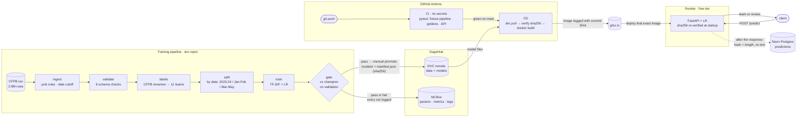
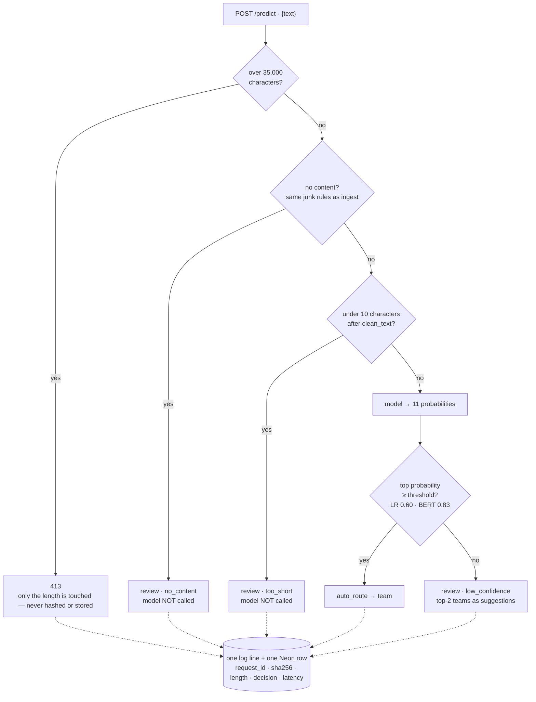

# Ticket Router

An **11-class complaint router**: it reads a customer complaint, sends it to the right product team, and sends uncertain ones to a human. Trained on the public **CFPB Consumer Complaint** dataset (2.9M rows), which stands in for a bank's support tickets. **Live:** https://ticket-router-hjiq.onrender.com (contract: [docs/api.md](docs/api.md)).

## The verdict

**BERT is the better model. LR is the deployed one, because BERT doesn't fit Render's free tier.**

| | Test macro-F1 | Misrouted per 1,000 (same 14.5% review workload) | Service p95 on Render free | Day 13 rule (p95 < 200ms, ≤512MB) |
|---|---|---|---|---|
| **LR** (TF-IDF + Logistic Regression), **deployed** | 0.656 | 46.8 | **3ms** | **pass** |
| BERT (`bert_small_en_uncased`, ONNX) | **0.686** | **34.2** (27% fewer) | 946ms | fail — ~5× too slow on 0.1 CPU |

- The rule was **written before any measurement** (Day 13) and applied unchanged on Day 20. It blocked the more accurate model because it doesn't meet the latency budget on the hardware we have.
- **What would flip it:** an instance with at least one full CPU, or a distilled/quantised BERT — re-measured with the same `scripts/latency.py`, not assumed. Switching is a one-line change (`params.yaml → serving.model: bert`); the image already ships both models.

## Deployment decision, in full

**Rule (Day 13):** deploy BERT if **p95 < 200ms and memory ≤ 512MB** on Render's free instance; otherwise deploy LR and record BERT's numbers as evidence.

| On Render free (100 val complaints, 2026-11-10) | Service median | Service p95 | End-to-end p95 | Memory* | Rule |
|---|---|---|---|---|---|
| LR | 2ms | **3ms** | 309ms | 121 MiB | **pass** |
| BERT (ONNX, 1 thread) | 235ms | **946ms** | 1,229ms | 252 MiB | **fail** (4.7× over) |

- **Service time** is the app's own `latency_ms`, stored in Neon. **End-to-end** includes the network — from my laptop, `/health` (no work at all) already takes ~270ms, so nothing passes 200ms end-to-end from a client's view. The spec was ambiguous between the two readings, but BERT fails under **either**, so the ambiguity never changed the decision.
- \*Memory is a **close local approximation, not Render's own figure** — measured in Docker with the free tier's limits (`--cpus 0.1 --memory 512m`). Docker's cgroup enforcement can differ slightly from Render's. Both models are far under 512MB, so **CPU fails BERT, not memory**.
- Both models gave **20/20 API parity** with the offline batch path on the live URL. The model is correct; it's just too slow on this hardware.

## Results

Time-based split: train 2023–2024, val Jan–Feb 2025, test Mar–May 2025 (test opened once, on Day 13, never touched again).
Metric: **macro-F1**. The biggest class (credit reporting) is 69% of train, 64% of val and 80% of test, so accuracy alone is misleading.

| Model | Val macro-F1 | Test macro-F1 | Test acc | Test macro-F1, deduplicated |
|---|---|---|---|---|
| **TF-IDF + Logistic Regression (deployed)** | 0.696 | 0.656 | 0.910 | 0.659 |
| LR, first 350 words | 0.694 | 0.656 | 0.909 | 0.659 |
| LSTM | 0.674 | 0.644 | 0.905 | 0.649 |
| BERT (`bert_small_en_uncased`, ONNX) | **0.721** | **0.686** | **0.916** | **0.686** |

BERT beats LR by **+0.021 to +0.034 macro-F1** (95% paired bootstrap CI, deduplicated test, 1,000 resamples).

**Review queue (validation).** Each model sends `confidence < threshold` to a human. Thresholds were chosen on validation so both models give staff the **same workload** — the rule was written before computing (see [`docs/api.md`](docs/api.md)):

| Model | Threshold | Sent to review | Its errors caught | Misrouted per 1,000 tickets |
|---|---|---|---|---|
| LR | 0.60 | 14.6% | 44.5% | 46.8 |
| BERT | 0.83 | 14.5% | 55.4% | **34.2** (27% fewer) |

## System design

### 1. End to end: from raw data to a live prediction



**Three design choices this diagram encodes:**
- **CI has no secrets; CD does.** CI proves the code on a synthetic fixture, on every push and PR. Only code that passed CI on `main` reaches CD — the one place that can pull models from DagsHub.
- **The model is baked into the image.** A cold start never touches DagsHub, and what runs on Render is the exact artifact built from a tested commit. `/version` reports that commit and every file's sha256.
- **Training and serving share code, not copies.** `clean_text` and the junk rules (`is_no_content`) are single functions used by both the pipeline and the API, so they can't drift apart (train/serve skew).

### 2. Inside one request



Thresholds were chosen **on validation** so both models send roughly the same share of tickets (~14.5%) to staff. If the database is down, the insert fails quietly (logged), and **the ticket is still routed** — a lost audit row is recoverable, a routing outage isn't.

### 3. What catches each failure

| What could go wrong | Caught by | When |
|---|---|---|
| Code change breaks the pipeline or the API | CI: fixture-trained smoke test + API tests (no data, no secrets) | Every push and PR |
| Text cleaning changes silently (train/serve skew) | Golden tests: 20 frozen text cases + 50 rows of exact BERT token IDs | Every push and PR |
| Retrained model is worse | Gate: macro-F1 floor 0.65, max drop 0.005, max drop 0.02 on any small class | `dvc repro` |
| Champion file swapped or corrupted | sha256 vs `models/manifest.json`, plus a recorded-score canary | Gate, CD (before build), API startup |
| Wrong model deployed | `/version` reports the git commit and every file's sha256 | Any time |
| Serving image bloats (pandas or TensorFlow creeps in) | Test that imports the serving path in a fresh process and checks `sys.modules` | Every push and PR |
| Database outage | Insert runs after the response; failures are logged, routing continues | Every request |
| Personal data leaks into logs | Only sha256 + length are logged or stored; the table has no text column | By design |

## Setup

```bash
git clone https://github.com/suvignan/Ticket-router && cd Ticket-router
python -m venv nlp && nlp\Scripts\activate            # Python 3.13
pip install -r requirements-train.txt                  # pipeline + tests (no TensorFlow)
pytest -q                                              # runs WITHOUT any data or secrets (synthetic fixture)
```

| File | For |
|---|---|
| `requirements-serve.txt` | The Docker image — API only (no pandas, no TensorFlow) |
| `requirements-train.txt` | + pipeline, DVC, MLflow, tests |
| `requirements-dev.txt` | + TensorFlow / KerasHub for the notebooks |

To get the data and models, add DagsHub credentials locally (never committed):

```bash
dvc remote modify origin --local auth basic
dvc remote modify origin --local user <dagshub-user>
dvc remote modify origin --local password <token>
dvc pull
```

Run the API locally: `uvicorn app.main:app`, with `DATABASE_URL` set to store prediction rows.
Or in Docker: `docker build -t ticket-router . && docker run -p 8000:8000 -e DATABASE_URL ticket-router`.

## How to retrain

```bash
dvc pull            # raw data + champion models
dvc repro           # re-runs only the stages whose inputs changed (run with the venv ACTIVE)
```

The `evaluate` stage is a **gate**: the new model must reach macro-F1 ≥ 0.65, may not drop more than 0.005 vs the champion, and no small class may drop more than 0.02 — all on validation. A failed gate stops the run, and both outcomes are logged to MLflow on DagsHub. Promoting a passing model to `models/` is a deliberate step: copy the files, update `models/manifest.json`, `dvc add` + `dvc push`, then commit. CD then builds and deploys exactly those files.

## Known limitations

- **Label noise.** The consumer picks the CFPB product, not a bank expert, so some "errors" are wrong labels. Credit reporting and debt collection overlap the most.
- **Drift.** Macro-F1 falls from val to test (LR 0.696 → 0.656, BERT 0.721 → 0.686) only 1–3 months later. The review shares chosen on validation drift too: on test, LR reviews 8.8% and BERT 19.0% (both ~14.5% on val). Production needs monitoring of the review share and a retraining trigger — today that's manual.
- **Company-name reliance.** Narratives name the company (when not redacted), and the model partly learns "company X → product Y." That won't transfer to one bank, where every ticket names the same company.
- **CFPB is not one bank.** US consumers writing to a regulator, about hundreds of companies, with `XXXX` redactions. A single bank's tickets differ in teams, vocabulary, length and channel. This is a proof of method; it needs retraining on the bank's own labelled tickets.
- **BERT reads only the first 350 words** (~90% of complaints in full). The response flags this (`truncated_for_model`).
- **Small classes** (e.g. prepaid card, vehicle loan) have far fewer examples and lower F1; macro-F1 averages them in regardless.
- **Free-tier hosting:** the instance sleeps after 15 min idle (cold start), with a fraction of a CPU and 512MB RAM.
- **No authentication or rate limiting** on the public endpoint. The 35,000-character limit is the only protection.
- **CI never loads the real model files** (it has no secrets), so a library upgrade that silently changes the frozen models' outputs would still pass CI. The fix: a reference-row check against the built image, run in CD.

## Notebooks

| # | Notebook | What it does |
|---|---|---|
| 01 | `01_data_loading.ipynb` | Load the raw CSV, keep 4 columns, run sanity checks (bad lines, duplicate IDs) |
| 02 | `02_eda.ipynb` | Class imbalance, volume over time, duplicates and template complaints |
| 03 | `03_labels.ipynb` | Merge renamed CFPB products, split the old card label, drop junk rows |
| 04 | `04_split.ipynb` | Time-based split: train 2023–2024, val Jan–Feb 2025, test Mar–May 2025 |
| 05 | `05_baseline.ipynb` | Text cleaning, TF-IDF + Logistic Regression baseline |
| 06 | `06_lstm.ipynb` | LSTM vs LR on truncated text |
| 07 / 07b | `07_transformer.ipynb`, `07b_bert.ipynb` | Fine-tune BERT (trained on Colab) |
| 7c | `7c_bert_onnx_export.ipynb` | Export BERT to ONNX for faster CPU serving |
| 08 | `08_test.ipynb` | One-time final test of all models + decision record |
| – | `memory_check.ipynb` | Peak memory check for serving |

## Incident log

- **2026-11-05:** a DagsHub access token was exposed (shared via an editor selection in a chat tool). It was revoked and replaced. Credentials now live only in git-ignored `.dvc/config.local` and `.env` locally, and in GitHub Actions secrets / Render environment variables in the cloud.
